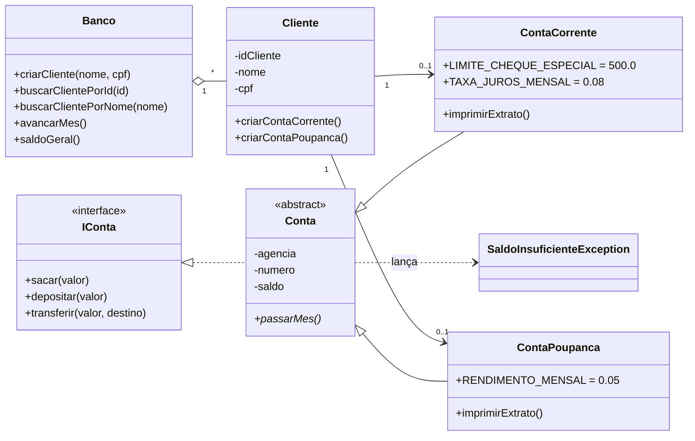
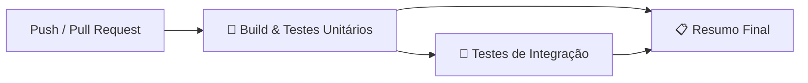

<div align="center">

# 🏦 Banco Digital

**Sistema bancário em Java, executado no terminal, com contas corrente e poupança, juros, rendimentos e uma bateria completa de testes automatizados.**


</div>

---

## 📖 Sobre o projeto

O **Banco Digital** é uma aplicação de linha de comando que simula as operações básicas de um banco: cadastro de clientes, abertura de contas, saques, depósitos, transferências e a passagem do tempo (mês a mês) com cobrança de juros e rendimento de poupança.

O projeto passou por uma **refatoração** voltada a qualidade de código e testabilidade: encapsulamento do saldo, validação de entradas, constantes nomeadas no lugar de números mágicos, menus desacoplados do `System.out` e uma suíte de testes unitários e de integração integrada a um pipeline de CI.

## ✨ Funcionalidades

- 👤 **Clientes**: cadastro com nome e CPF, ID gerado automaticamente, busca por ID ou por nome (sem diferenciar maiúsculas de minúsculas).
- 💳 **Conta Corrente**: cheque especial de **R$ 500,00** e juros de **8% ao mês** sobre o saldo devedor.
- 💰 **Conta Poupança**: rendimento de **5% ao mês** sobre o saldo.
- 🔁 **Operações**: saque, depósito, transferência (corrente ⇄ poupança, entre clientes ou do mesmo cliente) e extrato.
- ⏩ **Avanço de mês**: aplica juros e rendimentos em todas as contas do banco de uma só vez.
- 📊 **Saldo geral**: soma dos saldos de todas as contas de todos os clientes.
- 🛡️ **Validações**: valores não positivos, nome/CPF vazios, contas duplicadas e saldo insuficiente são tratados com exceções claras.

## 🧱 Arquitetura



| Classe | Responsabilidade |
|---|---|
| `Main` | Ponto de entrada; controla o fluxo de menus e a leitura do teclado. |
| `Menu` | Fornece os textos dos menus (retornam `String`, o que facilita testar). |
| `Banco` | Gerencia os clientes, o saldo geral e o avanço de mês. |
| `Cliente` | Dados do cliente e abertura das contas (no máximo uma de cada tipo). |
| `Conta` | Classe base abstrata: saldo encapsulado, saque, depósito e transferência. |
| `ContaCorrente` | Cheque especial e juros sobre saldo devedor. |
| `ContaPoupanca` | Rendimento mensal sobre o saldo. |
| `IConta` | Contrato das operações financeiras. |
| `SaldoInsuficienteException` | Exceção verificada para saques/transferências acima do disponível. |

## 🗂️ Estrutura de pastas

```
BancoDigital/
├── .github/workflows/
│   └── ci-pipeline.yml        # Pipeline de CI (build, testes e cobertura)
├── src/
│   ├── main/java/             # Código-fonte da aplicação
│   │   ├── Main.java
│   │   ├── Menu.java
│   │   ├── Banco.java
│   │   ├── Cliente.java
│   │   ├── Conta.java
│   │   ├── ContaCorrente.java
│   │   ├── ContaPoupanca.java
│   │   ├── IConta.java
│   │   └── SaldoInsuficienteException.java
│   └── test/java/             # Testes unitários e de integração
│       ├── SistemaBancarioTest.java
│       ├── FluxoCadastroClienteIT.java
│       ├── FluxoMovimentacaoFinanceiraIT.java
│       ├── FluxoAvancoMesIT.java
│       └── FluxoCasosLimiteIT.java
└── pom.xml
```

## 🚀 Como executar

### Pré-requisitos

- [JDK 17](https://adoptium.net/) ou superior
- [Maven 3.x](https://maven.apache.org/)

### Passo a passo

```bash
# 1. Clone o repositório
git clone https://github.com/SEU-USUARIO/BancoDigital.git
cd BancoDigital

# 2. Compile o projeto
mvn clean compile

# 3. Execute a aplicação
java -cp target/classes Main
```

### Exemplo de uso

```text
1- Criar Cliente
2- Acessar o cliente
3- Ver todos os Clientes
4- Ver Saldo geral do Banco
5- Avançar o mês
0- Sair
```

1. Escolha **1** para criar um cliente (informe nome e CPF).
2. Escolha **2**, pesquise o cliente por ID ou nome e abra uma conta corrente e/ou poupança.
3. Entre na conta para sacar, depositar, transferir ou ver o extrato.
4. Use **5** para avançar um mês e ver juros e rendimentos sendo aplicados.

## 💡 Regras de negócio

| Regra | Valor |
|---|---|
| Agência padrão | `1` |
| Número da conta | Sequencial, a partir de `1` |
| Limite do cheque especial (corrente) | R$ 500,00 |
| Juros sobre saldo devedor (corrente) | 8% ao mês |
| Rendimento (poupança) | 5% ao mês |
| Saque na poupança | Não pode ultrapassar o saldo |
| Valores de saque/depósito | Devem ser estritamente positivos |
| Contas por cliente | Uma corrente e uma poupança, no máximo |

## 🧪 Testes

O projeto separa os testes em duas camadas, executadas por plugins diferentes do Maven:

| Tipo | Plugin | Padrão de arquivo | Quantidade |
|---|---|---|---|
| Unitários | Surefire | `*Test.java` | 32 |
| Integração | Failsafe | `*IT.java` | 44 |

```bash
mvn test      # somente testes unitários
mvn verify    # unitários + integração
```

**Classes de integração:**

- `FluxoCadastroClienteIT`: cadastro, busca e abertura de contas.
- `FluxoMovimentacaoFinanceiraIT`: depósitos, saques, cheque especial e cadeias de transferências.
- `FluxoAvancoMesIT`: juros compostos, rendimentos e comportamento com vários clientes.
- `FluxoCasosLimiteIT`: valores inválidos, limites exatos e dados nulos ou vazios.

### 📈 Cobertura de código

O **JaCoCo** gera o relatório de cobertura automaticamente ao rodar `mvn test`. Abra o arquivo abaixo no navegador:

```
target/site/jacoco/index.html
```

## ⚙️ Integração contínua

O workflow em [`.github/workflows/ci-pipeline.yml`](.github/workflows/ci-pipeline.yml) roda a cada *push* em qualquer branch e em *pull requests* para `main` e `develop`:



1. **Build & Testes Unitários**: compila com JDK 17 (Temurin) e executa os testes, publicando os relatórios do Surefire e do JaCoCo como artefatos.
2. **Testes de Integração**: só executa se o job anterior passar; roda `mvn verify` e publica os relatórios do Failsafe.
3. **Resumo Final**: consolida o status e falha o pipeline se qualquer etapa falhar.

> 💡 Para exibir o status do pipeline aqui, adicione este *badge* trocando `SEU-USUARIO`:
>
> ``

## 🛠️ Tecnologias

- **Java 17**
- **Maven** (build e gerenciamento de dependências)
- **JUnit 5** (testes unitários e de integração)
- **Maven Surefire / Failsafe** (execução dos testes)
- **JaCoCo** (cobertura de código)
- **GitHub Actions** (CI)

## 🔭 Próximos passos

- [ ] Persistência dos dados (arquivo ou banco de dados)
- [ ] Tratamento de entradas inválidas no menu (letras no lugar de números)
- [ ] Validação do formato do CPF
- [ ] Histórico de transações no extrato
- [ ] Uso de `BigDecimal` no lugar de `double` para valores monetários

## 🤝 Contribuindo

Contribuições são bem-vindas!

1. Faça um *fork* do projeto
2. Crie uma branch: `git checkout -b feature/minha-feature`
3. Faça o commit: `git commit -m "feat: minha feature"`
4. Envie para o repositório: `git push origin feature/minha-feature`
5. Abra um *Pull Request*

## 👨‍💻 Autor

**Samuel Ponciano Marques da Silva**

[](https://github.com/SamuelPonciano)
---

<div align="center">

Feito com ☕ e Java

</div>
